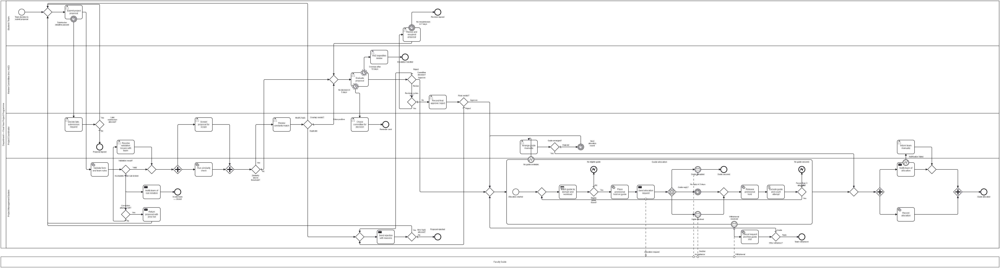
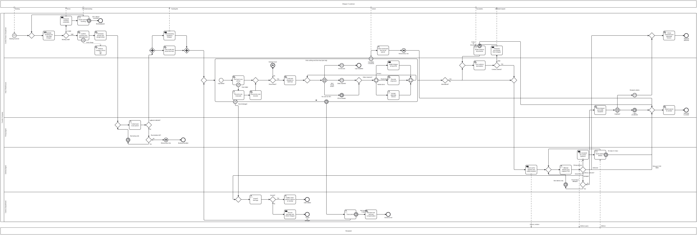
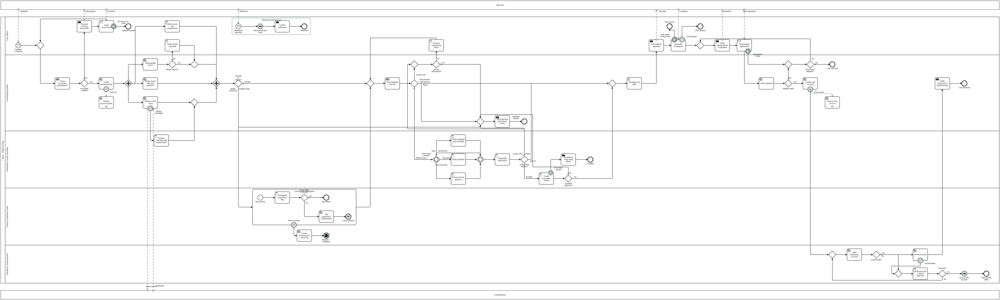

# BPMN Exception & Failure-Path Modelling — Exercise 3

Three business processes modelled in **BPMN 2.0** with the emphasis on what goes
wrong. Each model draws the happy path first, then every failure point found by
asking "what could go wrong here?" at each step, and resolves each one *inside the
diagram* with a proper construct: boundary events, bounded loops, event-based
gateways, escalation, error events, compensation and event sub-processes.

All three models are built for **Camunda 8**, use pools and lanes for every
participant in the brief, are syntactically valid BPMN 2.0, pass `bpmnlint`
(recommended rules + Camunda 8.8 compatibility), and pass the structural checks
in [`validate.py`](validate.py). They were also **deployed and executed on
Camunda 8.8**: 20 scenarios covering the happy paths and the failure paths
([results](#execution-test-on-camunda-88)).

| # | Assignment | Model | Diagram | Failure paths |
|---|---|---|---|---|
| 1 | Student Project Approval & Allocation System | [`01-student-project-allocation.bpmn`](01-student-project-allocation.bpmn) | [view](01-student-project-allocation.png) | F1 – F12 |
| 2 | Logistics & Shipment Exception Management | [`02-shipment-exception-management.bpmn`](02-shipment-exception-management.bpmn) | [view](02-shipment-exception-management.png) | E1 – E10 |
| 3 | Loan Origination & Approval System | [`03-loan-origination.bpmn`](03-loan-origination.bpmn) | [view](03-loan-origination.png) | L1 – L12 |

Modelling theory and the reasoning behind contested choices is in
[`DESIGN-NOTES.md`](DESIGN-NOTES.md).

---

## Repository structure

```
.
├── README.md                                This document — happy paths, Failure Path Registers, justifications
├── DESIGN-NOTES.md                          Modelling rationale and BPMN theory
├── validate.py                              Structural checks over all three models (stdlib only)
├── simulation/                              Deploys and runs scenarios on a local Camunda 8 Run
├── 01-student-project-allocation.bpmn       Assignment 1 model
├── 01-student-project-allocation.png        Assignment 1 diagram
├── 02-shipment-exception-management.bpmn    Assignment 2 model
├── 02-shipment-exception-management.png     Assignment 2 diagram
├── 03-loan-origination.bpmn                 Assignment 3 model
└── 03-loan-origination.png                  Assignment 3 diagram
```

---

## Notation used

| Symbol | Element | Meaning in these models |
|---|---|---|
| Thin circle | **Start Event** | Creates the instance; an envelope inside means it is started by a message |
| Thick circle | **End Event** | A terminal business outcome. ⚡ = error end, ● filled = terminate end |
| Double circle on a task border | **Boundary Event** | Something that can happen *while* the task runs. Solid border = interrupting, dashed = non-interrupting |
| ⏱ clock | **Timer** | A deadline or SLA |
| ✉ envelope | **Message** | Something arriving from another participant |
| ⚡ lightning | **Error** | A business or technical failure thrown by the task |
| ⏪ rewind | **Compensation** | Undo of an activity that already completed |
| Rounded rectangle, person icon | **User Task** | A person decides or acts; the instance waits |
| Rounded rectangle, gear icon | **Service Task** | Automated system work done by a job worker |
| Rounded rectangle, table icon | **Business Rule Task** | A decision made by rules (eligibility, pricing, matching) |
| Rounded rectangle, filled / hollow envelope | **Send / Receive Task** | Sends a message out / waits for a message in |
| Rounded rectangle, script icon | **Script Task** | Inline FEEL calculation, no worker needed |
| Diamond ✕ | **Exclusive Gateway** | Exactly one path |
| Diamond ＋ | **Parallel Gateway** | All paths at once / wait for all |
| Diamond ◯ | **Inclusive Gateway** | Every path whose condition is true / wait for those started |
| Diamond ⬠ in circles | **Event-based Gateway** | Whichever event happens first decides the path |
| Large rounded box | **Sub-process** | A self-contained stage; dotted border = event sub-process |
| Dashed arrow | **Message Flow** | Communication between pools |
| Dotted arrow | **Association** | Links a compensation boundary to its undo task |

---

# Assignment 1 — Student Project Approval & Allocation System



**Process ID:** `student-project-allocation`

## Participants

| Participant | Modelled as | Why |
|---|---|---|
| Student / Team | Lane | Submits and revises the proposal |
| Review Committee (incl. HoD) | Lane | Evaluates proposals; the HoD receives the overdue escalation |
| Project Coordinator | Lane | Screening and every manual fallback (late requests, manual allocation, manual notification) |
| Project Management System | Lane | Validation, similarity check, guide matching, records, notifications |
| Faculty Guide | Separate (black-box) pool | Each guide decides independently whether to accept a team. Their reply arrives as a message, which lets the process wait on it with an event-based gateway |

**Starts when** a student team decides to submit a proposal. **Ends when** a
guide is allocated and confirmed (*Guide allocated*), or the proposal is closed as
*Proposal rejected*, *Proposal lapsed*, *Revision lapsed*, *Invalid team* or
*Team withdrawn*.

## Happy path

```
Team decides to submit proposal
  → Submit project proposal                         (user task, Student)
  → Validate form and team rules                    (service task, System)
  → Validation result? = Valid                      (XOR)
  → ┌ Screen proposal for scope                      (user task, Coordinator)   ┐  parallel
    └ Run similarity check                           (service task, System)     ┘
  → Similarity above threshold? = No                (XOR)
  → Evaluate proposal                               (user task, Committee)
  → Committee decision? = Approve                   (XOR)
  → Guide allocation                                (sub-process, System)
       Match guide by domain and workload           (business rule task)
       Eligible guide found? = Yes                  (XOR)
       Place provisional hold on guide              (service task)
       Send allocation request                      (send task → Faculty Guide)
       Guide reply? → Guide accepted                (event-based gateway, message)
  → ┌ Notify team of allocation                      (send task)  ┐  parallel
    └ Record allocation                              (service task)┘
  → Guide allocated                                 (end)
```

## Failure Path Register

| ID | Failure point | Cause / trigger | Detected by | Solution and BPMN construct | Ends at |
|---|---|---|---|---|---|
| F1 | Proposal validation | Missing fields, no abstract, invalid roll numbers | XOR *Validation result?* = Incomplete (default) | *Return proposal with error list* (send task) loops back to the submit task. Loop is bounded by `validationAttempts < 2` (counted in an output mapping). After 2 failed rounds the case escalates to the coordinator: *Resolve validation issues with team* | Rejoins screening |
| F2 | Team rule check | Team too large, or a member is already in another team | XOR *Validation result?* = Team rule broken | *Notify team of rule violation* so the team can be reformed | *Invalid team — closed* |
| F3 | Duplicate / plagiarised topic | Similarity score above the threshold | XOR *Similarity above threshold?* | Coordinator *Review similarity match*. XOR *Overlap verdict?*: Duplicate → rejection path; Partial overlap → back to submit with *Modify topic*; False positive (default) → committee | Rejected, or rejoins |
| F4 | Submission deadline | Team does not submit in the 21-day window | Interrupting **timer boundary** on *Submit project proposal* | *Decide late-submission request* (coordinator). XOR *Late submission allowed?* Yes → submit again; No → lapse | *Proposal lapsed* |
| F5 | Committee asks for revision | Scope too large, vague objectives, weak novelty | XOR *Committee decision?* = Revise | Bounded **revision loop**: *Revision cycles left?* (`revisionCount < 2`) → *Revise and resubmit proposal* with a 7-day interrupting **timer boundary**. After 2 cycles the committee must *Record final approve / reject* | Rejoins committee, *Revision lapsed*, or final verdict |
| F6 | Committee rejects | Not feasible, out of syllabus, no resources | XOR *Committee decision?* = Reject (default) | *Send rejection with reasons*. XOR *New topic allowed?* (`rejections < 2`) lets the team try **one** new topic | *Proposal rejected* |
| F7 | Review delayed | Committee does not decide within the SLA | Two **non-interrupting timer boundaries** on *Evaluate proposal* | 5 days → *Chase committee for decision* (coordinator). 10 days → **escalation** to *HoD expedites review*. The review task keeps running throughout | Review continues |
| F8 | No guide available | Domain mismatch, or all matching guides at maximum load | XOR *Eligible guide found?* = No | **Error end** `NO_GUIDE` inside the sub-process, caught by an **error boundary** on *Guide allocation* → *Arrange guide manually* (direct appointment, co-guide, external guide). If not arranged → **wait-list** timer *Next allocation round* (7 days) and allocation re-runs | Rejoins allocation |
| F9 | Guide declines or is silent | Workload, conflict of interest, no response | **Event-based gateway** *Guide reply?*: message *Guide declined* or timer *No reply in 3 days* | *Release provisional hold* frees the slot, *Exclude guide and count attempt* (script task) and retry. Bounded: `allocationAttempts < 3`, then error `NO_GUIDE` → F8 path | Rejoins allocation |
| F10 | Notification failure | Mail service down | Worker retries 3 times, then throws `NOTIFY_FAILED` → **error boundary** on *Notify team of allocation* | *Inform team manually* (coordinator); both routes merge before the parallel join | Normal end |
| F11 | Withdrawal after approval | Team dissolves, or the approached guide goes on leave | Interrupting **message boundary** *Withdrawal received* on the *Guide allocation* sub-process | *Cancel request and free guide slot*, then XOR *Who withdrew?*: Team → end; Guide (default) → allocation re-runs | *Team withdrawn* or rejoins |
| F12 | Double booking of a guide | Same guide offered to two teams while deciding | — (prevented by design) | *Place provisional hold on guide* before sending the request; *Release provisional hold* frees it again on decline or timeout. *Record allocation* also retries 3 times on a database error | — |

## Task types — why each was chosen

| Task | Type | Reason |
|---|---|---|
| Submit project proposal, Revise and resubmit proposal | User | A student fills in a form; the process must wait for them |
| Screen proposal for scope, Review similarity match, Decide late-submission request, Resolve validation issues, Arrange guide manually, Inform team manually, Chase committee | User | Coordinator judgement or manual fallback |
| Evaluate proposal, Record final approve / reject, HoD expedites review | User | Committee / HoD judgement |
| Validate form and team rules, Run similarity check, Place provisional hold, Record allocation, Cancel request and free guide slot, Release provisional hold | Service | Deterministic system work with no human decision |
| Match guide by domain and workload | Business rule | Pure policy — domain match, availability, maximum load — that changes every term; belongs in a rule table, not in gateway conditions |
| Notify team of rule violation, Return proposal with error list, Send rejection with reasons, Send allocation request, Notify team of allocation | Send | The purpose of the step is to send a message to someone outside the system |
| Exclude guide and count attempt | Script | A one-line FEEL counter update; no worker needed |

## Gateways — why each was chosen

| Gateway | Type | Reason |
|---|---|---|
| *Validation result?*, *Committee decision?*, *Overlap verdict?* | Exclusive (3-way) | Outcomes are mutually exclusive; the conservative outcome is the default |
| *Correction attempts left?*, *Revision cycles left?*, *New topic allowed?*, *Fewer than 3 attempts?* | Exclusive | Loop guards that make every retry loop finite |
| Screening split / join | Parallel | Coordinator screening and the similarity check are independent; running them together halves the wait |
| Finish split / join | Parallel | Notifying and recording are independent; both must finish before the end |
| *Guide reply?* | Event-based | The process waits for *whichever happens first*: accept, decline, or 3 days of silence. An exclusive gateway cannot wait for events |
| Unnamed diamonds | Exclusive merge | Explicit merge wherever loops or alternative paths re-enter, so no task has two incoming flows and no gateway both joins and forks |

---

# Assignment 2 — Logistics & Shipment Exception Management



**Process ID:** `shipment-exception-management`

## Participants

| Participant | Modelled as | Why |
|---|---|---|
| Shipper / Customer | Separate pool (top) | External party: books, pays, corrects data, sends customs documents, may cancel |
| Control Tower / Dispatcher | Lane | Booking, payment, dispatch planning, customer messages, closure |
| Hub / Warehouse | Lane | Sorting, line-haul, customs filing, depot hold, returns |
| Pickup Agent | Lane | Collection from the shipper |
| Delivery Agent | Lane | Last-mile delivery |
| Claims Department | Lane | Damage claims and lost-parcel tracing |
| Recipient | Separate pool (bottom) | External party who receives, refuses or is unavailable |

**Starts when** a shipper books a shipment (message start). **Ends when** the
shipment is *delivered* and closed, *returned to sender*, or closed as *lost*,
*damaged*, *claim settled*, *booking cancelled* or *booking lapsed*.

## Happy path

```
Booking received                                    (message start, from Shipper)
  → Validate booking and calculate charges          (business rule task)
  → Booking valid? = Valid                          (XOR)
  → Confirm booking and take payment                (service task)
  → Schedule pickup and assign driver               (service task)
  → Collect and scan parcel                         (user task, Pickup Agent)
  → ┌ Send tracking update to shipper                (send task)    ┐ parallel
    └ Plan route and book line-haul                  (service task) ┘
  → Hub sorting and line-haul (per leg)             (multi-instance sub-process, one per hub leg)
       Sort and scan at hub → Parcel intact? = Yes → Load and dispatch to next hub
       → Next transit event? → Arrival scan → Leg completed
  → International? = No                             (XOR)
  → Send out for delivery and notify recipient      (send task → Recipient)
  → Attempt delivery and capture POD                (user task, Delivery Agent)
  → Delivery outcome? = Delivered                   (XOR)
  → Close shipment and generate invoice             (service task)
  → Shipment delivered                              (end)
```

## Failure Path Register

| ID | Failure point | Cause / trigger | Detected by | Solution and BPMN construct | Ends at |
|---|---|---|---|---|---|
| E1 | Pickup | Shipper absent, parcel not ready | XOR *Parcel collected?* = No (default) after *Collect and scan parcel* | XOR *Reschedules left?* → timer *Next pickup slot* (1 day, counts the attempt) → retry. Bounded to 2 reschedules, then **compensation** *Refund minus fee* undoes the payment | *Booking cancelled* |
| E2 | Address / booking data | Incomplete or wrong address, weight mismatch — at booking or at the door | At booking: XOR *Booking valid?*. At the door: XOR *Delivery outcome?* = Wrong address | Booking: *Request booking correction* → *Await corrected booking* (receive task) with 48 h **timer boundary**. Door: *Ask recipient for correct address* → *Await address details* with 2-day **timer boundary**; an out-of-zone change is surcharged at closure | Rejoins, *Booking lapsed* or return to sender |
| E3 | Damaged parcel | Damage found at hub scan or at delivery | Hub: XOR *Parcel intact?* → **error end** `PARCEL_DAMAGED` caught by **error boundary** on the transit sub-process. Door: *Delivery outcome?* = Damaged | *Inspect damage* → XOR *Insured?* → *Settle claim (refund, replace or reship)* or *Record damage and inform shipper* | *Claim settled* / *Closed as damaged* |
| E4 | Lost parcel | No scan for 48 hours | Interrupting **timer boundary** *No scan for 48 h* on the transit sub-process | *Trace parcel* (claims). Found → transit resumes for the remaining legs. Not found in 5 days (**timer boundary**) → *Declare lost and pay compensation* | *Closed as lost* or rejoins |
| E5 | Delay in transit | Weather, strike, breakdown, hub overload | **Event-based gateway** *Next transit event?*: message *Delay reported* or timer *ETA exceeded* | **Inclusive gateway** *Delay response?*: *Notify shipper of new ETA* always; *Reroute shipment* if the route is blocked; *Assign alternate vehicle* if the vehicle is down. Inclusive join, then wait again | Rejoins |
| E6 | Customs hold | Missing / incorrect export or import documents | XOR *Customs cleared?* = Held | *Request documents from shipper* (send) → *Await customs documents* (receive) with 5-day **timer boundary**; documents → re-file | Rejoins or return to sender |
| E7 | Recipient unavailable | Nobody at the address | XOR *Delivery outcome?* = Not at home (default) | Bounded loop *Fewer than 3 attempts?* → timer *Next delivery day*. After 3 attempts *Hold at depot* → **event-based gateway**: *Recipient collects* (message) or *7 days uncollected* (timer) | Delivered or return to sender |
| E8 | Refusal / COD failure | Recipient refuses, or cash-on-delivery fails | XOR *Delivery outcome?* | *Return parcel to sender*, charges adjusted | *Returned to sender* |
| E9 | Tracking / scan failure | Scanner offline, data mismatch | **Error boundary** `SCAN_FAILED` on the automated *Sort and scan at hub* service task (thrown by the sorter after its retries) | *Record scan manually* (supervisor) → *Reconcile scan records* → merge back into the leg | Rejoins |
| E10 | Cancellation after dispatch | Shipper cancels while in transit | Interrupting **message boundary** *Cancellation received* on the transit sub-process | *Stop movement and recall parcel* → **compensation** *Refund minus fee* (handler *Refund charges minus fee*) → return to sender | *Returned to sender* |

## Task types — why each was chosen

| Task | Type | Reason |
|---|---|---|
| Validate booking and calculate charges | Business rule | Address serviceability, weight bands, prohibited items and tariffs are policy tables |
| Collect and scan parcel, Attempt delivery and capture POD | User | Physical work by an agent who confirms the result on a handheld; the process waits for them |
| Sort and scan at hub | Service | Done by the automated sorter and scanner. As a job-worker task it can throw `SCAN_FAILED` (a Camunda user task cannot throw BPMN errors) |
| Record scan manually, Assign alternate vehicle, Stop movement and recall parcel, Inspect damage, Settle claim, Trace parcel | User | Human judgement / manual fallback |
| Confirm booking and take payment, Schedule pickup, Plan route, Load and dispatch, Reroute, Reconcile, File customs, Hold at depot, Declare lost, Return to sender, Close shipment | Service | Automated system work |
| Request booking correction, Send tracking update, Notify shipper of new ETA, Request documents, Send out for delivery, Ask recipient for address, Record damage and inform shipper | Send | Purpose is to message an external party |
| Await corrected booking, Await customs documents, Await address details | Receive | The process must stop and wait for a specific reply; the receive task carries the timeout boundary |
| Refund charges minus fee | Service (compensation handler) | Runs only when compensation is thrown |

## Gateways — why each was chosen

| Gateway | Type | Reason |
|---|---|---|
| *Booking valid?*, *Parcel collected?*, *Parcel intact?*, *International?*, *Customs cleared?*, *Insured?* | Exclusive | Binary, mutually exclusive outcomes |
| *Delivery outcome?* | Exclusive (5-way) | Exactly one outcome per attempt; *Not at home* is the safe, retryable default |
| *Reschedules left?*, *Fewer than 3 attempts?* | Exclusive | Loop guards |
| Dispatch split / join | Parallel | Customer update and route planning are independent |
| *Next transit event?* | Event-based | Arrival, delay report and ETA timeout race each other |
| *Collected?* | Event-based | Collection message races the 7-day hold timer |
| *Delay response?* + join | Inclusive | Several responses can apply at once (notify **and** reroute **and** replace vehicle), or only one |

---

# Assignment 3 — Loan Origination & Approval System



**Process ID:** `loan-origination`

## Participants

| Participant | Modelled as | Why |
|---|---|---|
| Applicant | Separate pool (top) | External customer — applies, sends documents, accepts, signs, may withdraw |
| Loan Officer | Lane | Owns the applicant relationship and the manual checks |
| Core Banking System | Lane | Automated checks, scoring, offer generation, account creation |
| Underwriter / Credit Committee | Lane | Credit judgement, extra checks, high-value approvals |
| Fraud & Compliance Team | Lane | Fraud / AML / sanctions investigations |
| Operations / Disbursement | Lane | Beneficiary verification and payout |
| Credit Bureau | Separate pool (bottom) — external, as the brief requires | Answers the credit report request |

**Starts when** an applicant submits an application with documents (message
start). **Ends when** the loan is *disbursed*, or the application is *rejected*,
*rejected — compliance* (terminate), *withdrawn*, *lapsed*, *offer expired*,
*offer declined*, *offer cancelled* or *disbursement failed*.

## Happy path

```
Application received                                (message start, from Applicant)
  → Check document completeness                     (business rule task)
  → Documents complete? = Yes                       (XOR)
  → Collect processing fee                          (service task)
  → ┌ Verify identity (KYC)                          (service task)                ┐
    ├ Screen fraud, AML and sanctions                (service task)                │ parallel
    ├ Retrieve credit score                          (service task ⇄ Credit Bureau)│
    └ Verify income and employment                   (user task, Officer)          ┘
  → Verification outcome? = All clear               (XOR)
  → Score eligibility and risk                      (business rule task)
  → Risk decision? = Manual review                  (XOR)
  → Extra checks required?                          (inclusive split → collateral / guarantor / EDD → inclusive join)
  → Underwrite application                          (user task)
  → Underwriting decision? = Approve                (XOR)
  → Generate loan offer                             (script task — EMI in FEEL)
  → Send offer to applicant → Await offer acceptance (send + receive)
  → Send agreement for e-signature → Await signed agreement (send + receive)
  → Verify signature → Signature valid? = Yes
  → Create loan account                             (service task)
  → Verify beneficiary account → Account valid? = Yes
  → Disburse funds                                  (service task)
  → Notify applicant of disbursement                (send task)
  → Loan disbursed                                  (end)
```

Low-risk applications skip the underwriter: *Risk decision?* = Auto-approve goes
straight to *Generate loan offer*.

## Failure Path Register

| ID | Failure point | Cause / trigger | Detected by | Solution and BPMN construct | Ends at |
|---|---|---|---|---|---|
| L1 | Document check | Incomplete or illegible documents | XOR *Documents complete?* = No | *Request missing documents* → *Await documents* (receive) with 7-day **timer boundary**; resubmission loops back to the check | *Application lapsed* or rejoins |
| L2 | KYC verification | Identity does not match official records | XOR *Identity matches?* = No | *Verify identity manually* (officer). If still unresolved, *Verification outcome?* routes to rejection with a reason code | *Application rejected* or rejoins |
| L3 | Fraud / AML / sanctions | Forged documents, AML pattern, sanctions hit | *Verification outcome?* = Compliance flag | Routed to the *Compliance investigation* sub-process (Fraud & Compliance lane). Confirmed → *File suspicious-activity report* → **error end** `FRAUD_CONFIRMED` → **error boundary** → *Freeze customer and close file* → **terminate end** (stops every remaining token, including the withdrawal listener). Cleared → scoring | *Rejected — compliance* or rejoins |
| L4 | Credit bureau call | API timeout / bureau down | Worker retries 3 times, then throws `BUREAU_UNAVAILABLE` → **error boundary** on *Retrieve credit score* | Fallback *Perform manual credit assessment* (underwriting) merges back into the parallel branch, so the join still completes | Rejoins |
| L5 | Credit score / risk | Score below cut-off | *Risk decision?* = Reject or Counter-offer | Reject → reason codes. Counter-offer → restructure (L6) | Rejected or restructured |
| L6 | Income / DTI | Income too low, DTI too high | *Risk decision?* or *Underwriting decision?* = Counter-offer | *Propose restructured terms* (smaller amount, longer tenure, guarantor) → re-score. Bounded: *Already restructured?* allows **once**, then reject | Rejoins or rejected |
| L7 | High-value / borderline | Above the underwriter's authority, borderline score | **Inclusive gateway** adds *Enhanced due diligence*; *Underwriting decision?* = Escalate | *Credit committee review* with a **non-interrupting timer boundary** (5-day SLA) → *Escalate to chief credit officer* while the review continues | Approved / rejected |
| L8 | Collateral valuation | Low valuation or title problems (secured loans) | Inclusive branch *Value collateral and check title* | Underwriter decides: low value → Counter-offer (lower LTV, re-score); unclear title → Reject | Rejoins or rejected |
| L9 | Offer acceptance | No reply within 15 days, or applicant declines | Interrupting **timer boundary** and **message boundary** on *Await offer acceptance* | Offer closed | *Offer expired* / *Offer declined* |
| L10 | Withdrawal at any stage | Applicant cancels | Interrupting **event sub-process** *Withdrawal at any stage* (message start) | **Compensation** throw *Reverse fees and holds* runs *Refund processing fee* and *Reverse loan account* for whichever were completed; *Confirm withdrawal* | *Withdrawn* |
| L11 | E-signature | Not signed in 5 days, or signature mismatch | **Timer boundary** on *Await signed agreement*; XOR *Signature valid?* | Bounded loop *Fewer than 2 attempts?* resends the agreement; after 2 failures the offer is cancelled | *Offer cancelled* or rejoins |
| L12 | Disbursement | Invalid beneficiary account, payment gateway error | XOR *Account valid?*; **error boundary** `PAYMENT_FAILED` (after 3 retries) on *Disburse funds* | *Hold funds and contact applicant* → *Resolved?* Yes → verify and pay again; No → **compensation** *Reverse loan account* | *Disbursement failed* or *Loan disbursed* |

## Task types — why each was chosen

| Task | Type | Reason |
|---|---|---|
| Check document completeness, Score eligibility and risk | Business rule | Product-specific document lists and credit policy (score, DTI, LTV thresholds) are decision tables owned by risk, versioned separately from the process |
| Verify identity (KYC), Screen fraud / AML, Retrieve credit score, Collect fee, Verify signature, Create loan account, Verify beneficiary, Disburse funds, File SAR, Freeze customer | Service | Automated integrations |
| Verify income and employment, Verify identity manually, Propose restructured terms | User | Officer judgement and phone calls |
| Perform manual credit assessment, Value collateral, Verify guarantor, Enhanced due diligence, Underwrite application, Credit committee review | User | Credit judgement |
| Investigate compliance flag | User | Investigator judgement |
| Hold funds and contact applicant | User | Operations follow-up |
| Generate loan offer | Script | EMI is a formula (`P·r / (1 − (1+r)^−n)`), evaluated inline in FEEL |
| Request missing documents, Send offer, Send agreement, Escalate to CCO, Send rejection, Notify disbursement, Confirm withdrawal | Send | Purpose is to message someone |
| Await documents, Await offer acceptance, Await signed agreement | Receive | Must wait for a specific reply and carry the timeout / decline boundaries |
| Refund processing fee, Reverse loan account | Service (compensation handlers) | Run only when compensation is thrown |

## Gateways — why each was chosen

| Gateway | Type | Reason |
|---|---|---|
| Verification split / join | Parallel | KYC, fraud screening, bureau score and income checks are independent. Each branch *always* reaches the join (failures are recorded, not ended inside the branch) so the join can never deadlock; the decision is made afterwards at *Verification outcome?* |
| *Risk decision?* | Exclusive (4-way) | One route per application; *Manual review* is the default so unexpected data reaches a human, never an automatic approval |
| *Extra checks required?* + join | Inclusive | Collateral, guarantor and EDD apply in any combination; the default *None* flow covers unsecured, small loans |
| *Underwriting decision?*, *Committee approves?* | Exclusive | Reject is the default |
| *Already restructured?*, *Fewer than 2 attempts?* | Exclusive | Loop guards |
| *Documents complete?*, *Identity matches?*, *Signature valid?*, *Account valid?*, *Resolved?*, *Fraud / AML confirmed?* | Exclusive | Binary outcomes |

---

## Element inventory

Produced by `python validate.py`.

| Model | Lanes | Pools | User | Service | Send | Receive | Rule | Script | XOR | AND | OR | Event-based | Boundary events | Sub-processes | End events | Flows |
|---|---|---|---|---|---|---|---|---|---|---|---|---|---|---|---|---|
| 1 — Project Allocation | 4 | 2 | 12 | 6 | 5 | 0 | 1 | 1 | 22 | 4 | 0 | 1 | 7 (4 timer, 2 error, 1 message) | 1 | 11 | 86 |
| 2 — Shipment Exceptions | 5 | 3 | 8 | 13 | 7 | 3 | 1 | 0 | 21 | 2 | 2 | 2 | 9 (5 timer, 2 error, 1 message, 1 compensation) | 1 (multi-instance) | 9 | 96 |
| 3 — Loan Origination | 5 | 3 | 11 | 12 | 7 | 3 | 2 | 1 | 23 | 2 | 2 | 0 | 10 (4 timer, 3 error, 1 message, 2 compensation) | 2 (1 event sub-process) | 12 | 98 |

Between them the three models use every construct the rubric names:
exclusive, parallel, inclusive and event-based gateways; interrupting and
non-interrupting timer boundaries; error, message and compensation boundaries;
error and terminate end events; bounded loops; escalation to a higher authority (HoD, chief credit officer);
embedded, multi-instance and event sub-processes; and compensation handlers.

---

## Validation

```bash
python validate.py
```

| Check (all three models) | Result |
|---|---|
| Well-formed XML, parses cleanly | Pass (3/3) |
| Every `sourceRef` / `targetRef` resolves to a flow node in the same scope | Pass (3/3) |
| Start events have no incoming flow; end events have no outgoing flow | Pass (3/3) |
| Every task, gateway and intermediate event has incoming and outgoing flow | Pass (3/3) |
| Every element reachable from a start event | Pass (3/3) |
| Every splitting XOR / OR gateway has a default (or always-true) flow and conditions on the rest | Pass (3/3) |
| Event-based gateways lead only to catch events | Pass (3/3) |
| No gateway both joins and splits | Pass (3/3) |
| No task has more than one incoming flow (merges are explicit) | Pass (3/3) |
| Every executable task carries its Zeebe definition | Pass (3/3) |
| Every message catch has a defined message with a correlation key | Pass (3/3) |
| Every error event references a defined error code | Pass (3/3) |
| Every element has `BPMNShape` / `BPMNEdge` diagram data | Pass (3/3) |
| Every top-level element sits in exactly one lane | Pass (3/3) |
| Every flow node carries a `<documentation>` entry | Pass (3/3) |

The models were also checked with **bpmnlint** (`bpmnlint:recommended` +
`camunda-compat/camunda-cloud-8-8`): **0 errors**. The only warnings are
`no-inclusive-gateway`, a style rule that discourages inclusive gateways in
general; the brief asks for them, so they are kept deliberately (see
[`DESIGN-NOTES.md`](DESIGN-NOTES.md#3-the-inclusive-gateways)).

---

## Execution test on Camunda 8.8

All three models were **deployed to a local Camunda 8 Run 8.8.32** and executed
end to end. [`simulation/run-scenarios.js`](simulation/run-scenarios.js) deploys
the models through the Orchestration Cluster REST API, then plays every other
participant: it completes jobs as the workers, completes user tasks as the
people, throws BPMN errors, and publishes the messages the shipper, recipient,
applicant, guide and bureau would send.

```bash
node simulation/run-scenarios.js          # needs Node 18+ and Camunda 8 Run on localhost:8080
```

| Scenario | Failure paths exercised | Result on Camunda |
|---|---|---|
| A1 happy path | — | Completed → *Guide allocated* |
| A1 correction round, similarity hit, revision, guide declines, mail down | F1, F3, F5, F9, F10 | Completed → *Guide allocated* |
| A1 team rule broken | F2 | Completed → *Invalid team — closed* |
| A1 no eligible guide | F8 | Completed → error caught → manual allocation → *Guide allocated* |
| A1 team withdraws during allocation | F11 | Completed → *Team withdrawn* |
| A1 rejected, new topic, rejected again | F6 | Completed → *Proposal rejected* |
| A2 happy path (2 hub legs) | — | Completed → *Shipment delivered* |
| A2 scan failure, delay with reroute, customs hold | E5, E6, E9 | Completed → *Shipment delivered* |
| A2 pickup fails | E1 | Waiting at *Next pickup slot* timer (as designed) |
| A2 not at home | E7 | Waiting at *Next delivery day* timer (as designed) |
| A2 damaged at hub, insured | E3 | Completed → *Claim settled* |
| A2 cancelled in transit | E10 | Completed → compensation *Refund charges minus fee* ran → *Returned to sender* |
| A2 refused at door | E8 | Completed → *Returned to sender* |
| A3 happy path (auto-approve) | — | Completed → *Loan disbursed* |
| A3 missing docs, manual KYC, bureau down, restructure, extra checks, committee | L1, L2, L4, L6, L7, L8 | Completed → *Loan disbursed* |
| A3 fraud confirmed | L3 | Completed → *Rejected — compliance* (terminate) |
| A3 score below cut-off | L5 | Completed → *Application rejected* |
| A3 applicant declines offer | L9 | Completed → *Offer declined* |
| A3 withdrawal at offer stage | L10 | Completed → event sub-process, *Refund processing fee* compensation → *Withdrawn* |
| A3 bad signature, payment fails, unresolved | L11, L12 | Completed → compensation (*Refund processing fee*, *Reverse loan account*) → *Disbursement failed* |

Timer paths measured in days (2-day, 5-day and 7-day waits) cannot finish in a
short test. Those scenarios were confirmed to reach and wait at the right timer.

The test run also found three problems, all now fixed in the models:

1. A task with an output mapping passes on **only** the mapped variables. The
   validator's result never reached *Validation result?*, so the result is now
   mapped explicitly.
2. A compensation throw **inside an embedded sub-process** never starts its
   handler on Camunda 8.8, so Assignment 1 releases the guide hold with an
   ordinary task (see [`DESIGN-NOTES.md`](DESIGN-NOTES.md#5-compensation-versus-just-another-task)).
3. Camunda user tasks cannot throw BPMN errors. *Pickup failed* is now a gateway
   after the pickup task, and hub scanning is an automated service task.

---

## Modelling conventions applied

1. **Happy path on one horizontal line** where the layout allows, with failure
   handling branching above or below it.
2. **Tasks are named verb-first**, gateways as questions, and every outgoing
   gateway flow is labelled with its answer.
3. **Every splitting gateway has a default flow**, and the default is always the
   *conservative* outcome (reject, not at home, manual review, incomplete).
4. **Every loop is bounded** by a counter kept in a process variable
   (`validationAttempts`, `revisionCount`, `allocationAttempts`,
   `pickupReschedules`, `deliveryAttempts`, `signAttempts`, `restructured`) and
   checked by an exclusive gateway, so no instance can loop forever.
5. **Every external wait has a timeout.** Every receive task, every
   event-based gateway and every wait on a student, applicant, shipper or
   guide has a timer, so a silent party cannot leave an instance stuck.
6. **Merges are explicit gateways**, so no task has two incoming flows.
7. **Distinct end events for distinct outcomes**, named after the business
   result, so each outcome can be counted separately in monitoring.
8. **Element IDs are semantic** (`Gw_GuideReply`, `Bnd_NoScan`), and **every
   element carries `<bpmn:documentation>`** naming the failure ID it handles.

---

## Assumptions

- **Assignment 1** — the Faculty Guide is drawn as a separate pool rather than a
  lane so that the guide's reply can be awaited with an event-based gateway (a
  lane in the same pool cannot exchange messages). The brief allows lanes *or*
  pools.
- **Assignment 1** — the submission window is 21 days and the review SLA is 5 /
  10 days. These are illustrative values held in the timer definitions.
- **Assignment 1** — a team gets one fresh topic after the first rejection.
  After a second rejection the proposal is closed.
- **Assignment 2** — the transit sub-process runs once per hub leg
  (`remainingLegs`). After a successful trace, the route planner recomputes the
  remaining legs, so the sub-process restarts only for the legs still to run.
- **Assignment 2** — "found" during tracing is shown by completing *Trace
  parcel*. "Not found" is the 5-day timeout.
- **Assignment 3** — the Credit Bureau is an external black-box pool (as the
  brief specifies). Request and response are shown as message flows on the
  service task that calls it.
- **Assignment 3** — the processing fee is collected after the document check,
  so a withdrawal or failed disbursement has something to compensate.
- **All** — service, send and business-rule tasks are implemented as Zeebe job
  workers (`zeebe:taskDefinition`). User tasks reference external forms. The
  model deploys and runs, and it waits at each service task until a worker
  subscribes. This is expected engine behaviour, not a modelling defect.

---

## Opening and running the models

1. Open [Camunda Desktop Modeler](https://camunda.com/download/modeler/).
2. `File → Open File`, then select any `.bpmn` file from this repository.
3. To execute a model, start a local Camunda 8 Run engine and deploy it with the
   rocket button (cluster endpoint `http://localhost:26500`).
4. Start an instance with the play button and follow it in Operate at
   `http://localhost:8080/operate`. User tasks appear in Tasklist at
   `http://localhost:8080/tasklist`.
